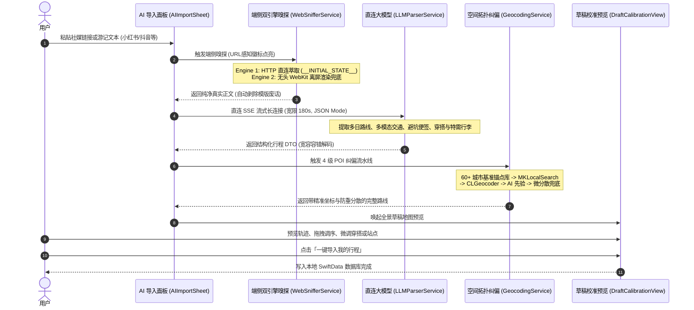
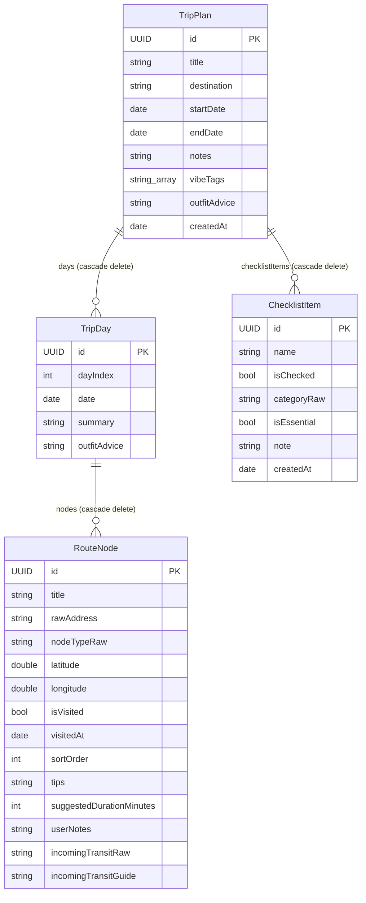

# 「你的旅游」（JustYourTrip）产品功能说明文档 (Product Specification)

> **文档版本**：v1.0.0  
> **更新时间**：2026-10-19  
> **文档状态**：正式发布（Release）  
> **适用终端**：iOS / iPadOS 17.0+ 原生单机向应用  
> **技术架构**：Swift 6 + SwiftUI + SwiftData + MapKit (纯端侧驱动)

---

## 一、 产品概述与核心价值

### 1.1 产品定位
「你的旅游」（英文名：*JustYourTrip*）是一款面向独立旅行者、Citywalk漫游者与特种兵出行用户的**闭环个人出行管理中枢**。

区别于市面上依赖中心化后端、重社交推荐、广告充斥的商业旅游应用，JustYourTrip 恪守**本地优先（Local-First）、零服务器开销、绝对隐私、丝滑互联**的纯极客理念，将**小红书等社媒攻略提取、多模态真实交通路网串联、地图底板抽屉交互、行前装备管理与旅行足迹回忆**完整闭环于用户本地设备之中。

### 1.2 核心设计哲学
1. **本地优先（Local-First）**：
   - 100% 离线可用，不依赖任何第三方租户服务器，数据秒存秒取，无网络状态下照常检索全量行程与路线。
2. **绝对隐私与 BYOK（Bring Your Own Key）**：
   - AI 能力直连大模型开放接口（兼容 OpenAI / DeepSeek / Kimi 等标准协议），API Key 纯端侧加密存储，绝不经过中转代理服务器，绝不上报用户行程隐私。
3. **真实路网与多模态交通串联（Multi-modal）**：
   - 绝非只有“景点 A 到景点 B”的抽象连线，而是将地铁出入口、公交停靠点、停车场深度结构化纳为行程节点，无缝唤醒本机高德/百度/Apple 地图进行真实导航。
4. **极致美学与手账质感（Muzli / Apple HIG）**：
   - 采用深邃森林极深绿（`#0D2620`）基调与鼠尾草微光薄荷（`#52B788`）高光，搭配多层物理纸质感堆叠、毛玻璃描边与微阻尼触觉震动反馈，呈现高质感旅行路书体验。

---

## 二、 目标用户画像与核心场景

| 用户类型 | 核心痛点 | JustYourTrip 解决方案 |
|---|---|---|
| **小红书/社媒攻略收集狂** | 收藏了大量图文游记，但在实际出行时翻找零乱、地名重合、无法转变为直观地图动线 | **端侧双引擎 AI 智能嗅探**：一键粘贴短链，秒级提取多日行程，并利用城市锚点纠偏上图 |
| **Citywalk / 特种兵自由行** | 每天路线紧凑，换乘复杂，频繁在备忘录与导航软件之间复制粘贴切屏 | **抽屉式时光轴 + 多模态连线 + 一键导航中继**：详细到几号口出的换乘指示，一键唤醒高德/百度 |
| **多日连线长途漫游者** | 每天行程孤立断裂，看不出跨日路线过渡，晚上不知住哪、第二天不知从哪起步 | **全景总览模式 + 跨日渐变虚线桥梁**：多日轨迹分色共显，清晰渲染夜间休整过渡 |
| **隐私敏感 / 极客驴友** | 担心个人出行足迹被商业公司大数据追踪画像，受困于应用频繁改版与广告推送 | **Local-First + BYOK + 离线数据保险库**：无账号、无服务器、支持全量 JSON 导出与导入 |

---

## 三、 产品功能架构（Information Architecture）

```mermaid
graph TD
    App["JustYourTrip 你的旅游 (iOS/iPadOS)"]

    App --> Tab1["1. 行程规划 (Trip Planner)"]
    App --> Tab2["2. 足迹大地图 (Footprint Map)"]
    App --> Tab3["3. 行前准备 (Checklist)"]
    App --> Tab4["4. 设置中心 (Settings & Vault)"]
    App --> Cross["5. 贯穿能力 (Cross-cutting)"]

    %% Tab 1
    Tab1 --> T1["行程画册卡片流 (TripListView)"]
    Tab1 --> T2["地图底板一体化抽屉 (TripDetailMapView)"]
    Tab1 --> T3["全景总览模式 (All-Days Overview)"]
    Tab1 --> T4["多模态节点管理 (RouteNode CRUD)"]
    Tab1 --> T5["智能穿搭指南 (Outfit Advice)"]

    %% Tab 2
    Tab2 --> F1["足迹聚类大地图 (FootprintMapView)"]
    Tab2 --> F2["漫游探索成就岛 (Achievement Island)"]
    Tab2 --> F3["中转站智能过滤与分类筛选"]
    Tab2 --> F4["明信片风回忆卡片 (FootprintCardView)"]

    %% Tab 3
    Tab3 --> C1["双环形打包收纳仪表盘"]
    Tab3 --> C2["六大分类手账折叠卡片"]
    Tab3 --> C3["经典出行模版一键套用 (12项)"]
    Tab3 --> C4["行程专属与全局清单联动"]

    %% Tab 4
    Tab4 --> S1["旅行护照 Header"]
    Tab4 --> S2["BYOK 大模型密钥与连通性 Ping"]
    Tab4 --> S3["离线全量 JSON 备份与恢复 (Data Vault)"]
    Tab4 --> S4["官方示例一键重置"]

    %% Cross
    Cross --> AI["双引擎端侧 AI 攻略导入流水线"]
    Cross --> Nav["三端导航中继 (NavigationRelayService)"]
    Cross --> Geo["城市锚点与 4 级 POI 纠偏系统"]
```



---

## 四、 核心功能模块详细说明

### 4.1 模块一：行程规划与管理（主 Tab）

#### 4.1.1 行程首页与卡片流（`TripListView`）
- **探索感 Header**：动态展示 *Where Will You Go Next?* 品牌视觉，配有探索指南。
- **现代旅行路书画册卡片（Modern Travel Card）**：
  - **智能出行状态徽标**：根据起始与截止日期自动流转并展示状态：
    - `今日出发`（高亮珊瑚红渐变）；
    - `旅途中`（进行中动态胶囊）；
    - `X天后出发`（出行倒计时）；
    - `已全部打卡 / 漫游回忆`（历史归档态）。
  - **精选路线亮点速览（Mini Itinerary Stepper）**：卡片上直观提取前 3 站精选打卡点（带景点/美食/交通图标）及“+N 站”剩余站数徽章。
  - **Trip Vibe 情绪风格标签**：支持「自然风光、城市漫游、历史古迹、特种兵刷步、微醺夜游、海岛度假、人文艺术、硬核徒步、美食品鉴」等标签呈现。
  - **穿搭速览微标**：卡片直接透出着装关键标签（如 `#防风外套`、`#轻便暴走鞋`）。
  - **原生缩放转场（Zoom Transition）**：点击卡片基于 iOS 18 原生 Zoom 动效平滑展开放大进入地图详情页，返回时平滑缩放归位。

#### 4.1.2 一体化底板与抽屉联动系统（`TripDetailMapView`）
- **纯原生内嵌抽屉架构（In-View Bottom Drawer）**：
  - 彻底抛弃系统独立模态弹窗，将地图底板、顶部悬浮控制岛与底部时间轴抽屉纳入同一视图层次树。
  - 返回时地图与抽屉 100% 毫秒级同步平滑退出，支持原生屏幕边缘侧滑返回。
- **物理阻尼多档位吸附（DrawerDetent）**：
  - `折叠态（collapsed ~210pt）`：露出首个关键站点卡片，最大化腾出全屏地图视野；
  - `半屏态（medium 48%）`：地图视野与时间轴平衡并重；
  - `全屏态（expanded）`：向上拉满时间轴，留出顶部控制岛，沉浸式阅读行程与避坑指南；
  - 具备惯性速度吸附、微阻尼回弹，支持轻按抓手或双击折叠键自适应切换。
- **顶部悬浮控制岛**：
  - 半透明毛玻璃胶囊形态，常驻返回按钮、当前天数与站点统计信息；
  - 包含「一键全览（Focus All）」功能：点击自适应计算几何包围盒，并自动将抽屉降至折叠态，呈现当日完整路线全貌。

#### 4.1.3 全景总览模式与跨日交接桥梁（All-Days Overview Mode）
- **天数切换栏专属总览胶囊**：横向切换栏首位常驻「🗺️ 全景总览 · N天」胶囊，与 `Day 1`、`Day 2` ... `Day N` 无缝平滑切换。
- **多日轨迹多色共显**：
  - 全景模式下，各天线路按其专属主题色（墨绿、珊瑚红、琥珀金、优雅紫、湖海青等）同时渲染实线连线；
  - 图钉徽标动态展示 `D1-1`、`D1-2`、`D2-1`，图钉光晕匹配所属天数专属色彩。
- **跨日过渡渐变虚线桥梁（Cross-day Bridge Polyline）**：
  - 算法自动抓取 Day $K$ 最后一站与 Day $K+1$ 第一站，在地图上绘制精美渐变虚线（Dash `[8, 6]`），直观呈现夜间迁移与次日启程的地理空间过渡。
- **连续时间轴与跨日交接卡片**：
  - 抽屉内按天连续展开所有站点，每日前置带专属色彩小圆点的 Day 分组标题栏，支持一键「只看这天」秒切单日专注模式；
  - 各天之间穿插渐变双色轴线与「🌙 夜间休整 · 跨日衔接」卡片，清晰呈现从上一天终点（如酒店）到次日首站（如晨间景点）的行程过渡；
  - 在单日专注模式下，顶部自动渲染「🌅 承接前日行程」快捷查看条，底部渲染「🌙 结束今日 · 次日启程预告」跳转卡片。

#### 4.1.4 多模态混合交通节点与打卡流转（`RouteNode`）
- **节点类型支持（`NodeType`）**：
  - `景点（attraction）`、`餐饮（restaurant）`、`住宿（hotel）`、`公交站（transitBus）`、`地铁站/出入口（transitSub）`、`停车场（parkingLot）`、`其他（other）`。
- **路段交通连线（`TransitType`）**：
  - 步行（虚线）、自驾/打车（实线）、公共交通（粗线/专属彩色）。
  - 节点卡片附带详细换乘指引（例如：“乘地铁2号线往浦东机场方向，坐3站至陆家嘴站C口出”）。
- **打卡状态机流转**：
  - 单击节点「打卡」按键，触发触觉震动反馈；
  - 节点状态由“待去（白色发光数字图钉）”流转为“已打卡（鼠尾草薄荷绿完成态）”；
  - 已打卡卡片自动柔和变灰，时间轴光晕下移至下一待去站点，顶部进度条实时更新。

#### 4.1.5 行程全生命周期闭环（CRUD & 自由调度）
- **查（View）**：高精地图多模态轨迹、数字序号图钉、竖向步进时间轴、避坑便签协同浏览。
- **增（Create）**：
  - 支持在指定天任意追加打卡点（`AddNodeSheet`）；
  - 天数切换栏末尾支持一键「+ 加一天（`addNewDay`）」动态扩展行程跨度。
- **删（Delete）**：
  - 卡片右上角快捷操作与长按 ContextMenu 集成红色安全删除，带 `confirmationDialog` 二次防误触弹窗；
  - 支持长按天数胶囊删除冗余天数（自动执行模型级联删除）。
- **改（Update & Cross-day）**：
  - 通过 `EditNodeSheet` 全要素修改地名、分类、建议停留时长、交通指引、避坑指南；
  - 支持内置地图精准检索纠偏；
  - 支持「所属天数日程」Picker 快捷跨天调度，自动双向重算天内序号。
- **调（Reorder & Drag）**：
  - 快捷单步调序：卡片内置「上移一位」与「下移一位」触感交互；
  - 全景拖拽排序：抽屉常驻「调序」按键，呼出 `ReorderNodesSheet` 原生列表拖拽视窗，按住滑块自由重排整天站点，实时刷新时间轴与地图连线。

---

### 4.2 模块二：混合交通导航中继服务（`NavigationRelayService`）

- **无缝生态外链**：解决应用内自研地图渲染无法提供复杂实时路况与语音巡航播报的短板。
- **智能客户端检测**：通过 iOS URL Scheme 动态检测用户本机是否安装：
  - **高德地图**（`iosamap://path`）
  - **百度地图**（`baidumap://map/direction`）
  - **Apple 原生地图**（`maps.apple.com`）
- **全要素参数透传**：
  - 呼起导航时自动透传目标节点经纬度坐标、地点名称、出行交通方式（驾车/公交/步行）；
  - 若已安装三方地图，弹出 ActionSheet 供用户优先选择；若未安装三方地图，自动无感降级唤起系统自带 Apple 地图。

---

### 4.3 模块三：智能穿搭指南系统（AI Outfit System）

- **AI 智能提取与上下文时令推荐**：
  - 在社媒攻略导入时，自动深度解析原笔记中的穿衣穿搭、鞋帽装备、防风防晒建议；
  - 若原文未提及，AI 结合目的地气候特征、季节时令与活动强度（如暴走步行多、江边/山顶风大、拍照出片等）生成贴心实用的穿搭指南。
- **草稿校准人机协同自主编辑**：
  - 导入预览校准页专属「👔 AI 出行穿衣推荐与穿搭指南」手账卡片；
  - 支持在入库前进入 `EditDraftOutfitSheet` 随时修改，提供常用标签流（`#早晚温差备外套`、`#轻便平底暴走鞋`、`#浅色系拍照出片`、`#洋葱穿法`）与一键目的地模版。
- **行程抽屉与卡片深度集成**：
  - 抽屉顶部快捷操作栏常驻「穿搭」胶囊按键，任意形态一键呼出查看或编辑；
  - 全景总览模式展示全程指南，单日模式优先展示当日专属穿搭并无缝回退至全程指南；
  - 离线全量 JSON 备份与官方示例中均深度集成穿搭数据。

---

### 4.4 模块四：社媒攻略 AI 导入流水线（AI Import Pipeline）



#### 4.4.1 全场景链接感知与清洗
- 支持精准识别小红书（`xhslink.com/...`）、抖音（`v.douyin.com/...`）、微信公众号、携程、马蜂窝等各类带/不带协议头网址与短链接；
- 自动剥除分享文本末尾夹带的中文标点与废话干扰。

#### 4.4.2 双引擎端侧抓取架构（Dual-Engine Architecture）
- **Engine 1（高速 HTTP 直连，耗时仅 ~0.3s）**：
  - 自动跟随 302 重定向；
  - 专精萃取小红书 `window.__INITIAL_STATE__` / `__INITIAL_DATA__`、`og:description`、`<meta name="description">`、`<title>` 与去除标签后的文章真实段落正文。
- **Engine 2（无头 WebKit 离屏降级兜底）**：
  - 针对重客户端 JS 渲染的 SPA 动态页面，提供 100x100 离屏真实 DOM 注入与执行，防止被 iOS WebKit 激进节流。
- **社媒模版文案净化（`cleanSocialBoilerplate`）**：
  - 自动过滤“快来看吧！复制本条信息打开小红书 App”等模版废话，萃取真正有效的游记攻略正文。
- **反爬友好拦截指引**：
  - 若平台因反爬滑块拦截且用户未贴文案，立即阻断向大模型传递死链（杜绝大模型幻觉与报错），并在界面以高亮卡片给出清晰指引：“请在小红书长按文案选择「复制文案」，直接粘贴到输入框”，并附带一键重试与示例按钮。

#### 4.4.3 3 大核心主阶段与 9 大细分子步骤流水线
- **阶段 1：网页嗅探与文本准备**
  - 步骤 1：识别链接与准备抓取
  - 步骤 2：端侧抓取正文与模版净化
  - 步骤 3：文本就绪，构建结构化 Prompt
- **阶段 2：AI 智能行程解构**
  - 步骤 4：直连大模型长连接（SSE 宽限 180s）
  - 步骤 5：解构多日路线与多模态交通
  - 步骤 6：生成穿衣推荐、避坑建议与行前清单
- **阶段 3：空间拓扑与地理校准**
  - 步骤 7：锁定目的地基准城市锚点
  - 步骤 8：逐站高精 POI 校准（动态显示“第 X/N 站：地点名”）
  - 步骤 9：空间拓扑防重与离群优化

#### 4.4.4 60+ 热门城市基准锚点库与 4 层级混合高精 POI 纠偏
- **City Anchor Database**：内置全国 60+ 热门旅游城市高精中心基准，动态以目的地为几何原点约束检索范围（`region: 80km`），从根源杜绝“同名景点跳往外省”造成的巨大飞线。
- **4 层级高精 POI 纠偏管道（Multi-tier Resolution Pipeline）**：
  - **Tier 1（MapKit 原生 POI 检索）**：调用 `MKLocalSearch` 结合城市 Region 约束，精准秒级解析地标（如“武康大楼”、“安福路”、“东方明珠”）；
  - **Tier 2（CLGeocoder 地址反查）**：带城市前缀且施加 120km 离群阻断校验，拦截异地同名点；
  - **Tier 3（AI 经纬度先验注入与校准）**：大模型结构化输出先验经纬度，在符合城市半径时双向校验采纳；
  - **Tier 4（智能微分散局部兜底）**：未命中的罕见点自动依附于当日游玩前序站点，并施加角度微分散偏移，绝不堆叠重合。
- **拓扑健康度检查**：距离 < 20 米的异名站点自动向外分散（~180m），严重离群点强制拉回。

#### 4.4.5 草稿人机校准与一键入库（`DraftCalibrationView`）
- 带实线轨迹连线 `MapPolyline`、数字序号 Pin、一键全览当日视野；
- 支持在校准阶段上下拖拽重排顺序（`.onMove`）、左滑删除（`.onDelete`）、微调经纬度与游玩时长（`EditDraftNodeSheet`）；
- 行前特需物品与穿搭指南一键同步存入 SwiftData。

---

### 4.5 模块五：全局足迹大地图（Tab 2）

#### 4.5.1 视觉与成就岛（`FootprintMapView`）
- **漫游探索成就岛（Achievement Header Island）**：顶部悬浮展示探索城市统计（如“探索 3 座城市”）、打卡回忆计数微标（如“点亮 18 个足迹”）。
- **全局打卡足迹聚类展示**：沉浸式深色大地图，聚合渲染所有已完成打卡（`isVisited = true`）的历史节点。

#### 4.5.2 智能过滤与多维度筛选
- **智能中转站过滤**：右上角提供“隐藏中转站”开关，自动剥离公交站、地铁口与停车场，足迹墙仅保留纯粹的风景、美食与人文。
- **多分类快捷筛选条**：支持在地图上快速筛选「全部 / 景点 / 美食 / 住宿」点位。

#### 4.5.3 明信片手账风回忆卡片（`FootprintCardView`）
- 轻触历史足迹图钉，底部弹出轻量明信片风卡片；
- 呈现复古旅行邮戳徽章、打卡完成时间戳、所属行程计划名称与避坑手账随笔。

---

### 4.6 模块六：行前准备（Checklist 打包助手，Tab 3）

#### 4.6.1 双环形打包收纳仪表盘
- 顶部实时渲染双层圆形环状进度条：
  - 外环：所有物品收纳总进度百分比；
  - 内环：高优先级特需/关键必备物品完成状态。

#### 4.6.2 六大分类手账折叠卡片
- **分类维度**：
  1. `证件票务`（身份证、护照、交通卡、门票等）
  2. `数码装备`（充电宝、相机、转换插头、云台等）
  3. `穿搭衣物`（换洗衣物、舒适跑鞋、墨镜、雨具等）
  4. `个人药品`（晕车药、创可贴、感冒药、驱蚊液等）
  5. `个护洗漱`（旅行分装瓶、毛巾、防晒霜、洗漱包等）
  6. `其他定制`（U型枕、保温杯、零食等）
- 支持分类独立展开/折叠、分类专属彩色徽章与已收纳/待收纳计数胶囊。

#### 4.6.3 触感交互与模版快捷套用
- 勾选物品伴随 Taptic 触感反馈、文本删除线动画与完成状态平滑位移，支持右滑快速删除；
- **一键套用 12 项经典模版**：内置新手出游必备清单，一键快速填装行李；
- **按行程切换胶囊条（Trip Picker Bar）**：自由在全局通用清单与各个独立行程打包清单间无缝切换。

---

### 4.7 模块七：设置中心与数据保险库（Tab 4）

#### 4.7.1 旅行护照风 Header
- 采用极客旅行签注设计，凸显“本地优先（Local-First）· 端侧纯净驱动 · 零商业上报”认证徽标。

#### 4.7.2 BYOK（自带密钥）配置与连通性 Ping
- **多模型预设一键切换**：支持 DeepSeek、OpenAI、Kimi、硅基流动等兼容协议，支持自定义 Base URL 与 Model Name；
- **端侧 Ping 延迟测试**：内置轻量探测请求，实时测量本地直连大模型 API 的往返毫秒数（Ping Latency），清晰感知网络可用性；
- **本地安全持久化**：密钥严格保存在端侧 Keychain / UserDefaults，杜绝中转泄露。

#### 4.7.3 离线全量 JSON 数据备份与恢复（Data Vault）
- **一键全量导出**：将用户所有行程计划、多日日程、节点坐标、换乘指引、穿搭指南与行李清单完整打包生成标准化 `.json` 文件；
- **系统分享与本地存档**：支持唤起 iOS 原生系统分享面板（可存至“文件”、隔空投送 AirDrop 发送至 Mac/iPad 或发送微信文件助手）；
- **全量无损恢复**：支持选择本地备份 `.json` 文件一键恢复，自动重构 SwiftData 模型并刷新界面。

#### 4.7.4 官方示例行程体验与重置
- 提供上海经典外滩与梧桐区漫游官方示例行程，支持一键重置与追加体验。

---

## 五、 数据模型与关系设计（SwiftData Architecture）



### 级联删除与数据完整性规范
- `TripPlan` 删除时，其关联的 `TripDay`、`RouteNode` 及该行程专属的 `ChecklistItem` 全部自动执行 `.cascade` 级联删除，不留游离孤立数据。
- 排序字段 `sortOrder` 在节点删除、跨天移动或拖拽重排时，受闭环业务逻辑保障，严格保持自增连续无空洞。

---

## 六、 视觉规范与设计系统（Design System）

统一维护于 `JustYourTrip/Theme/AppTheme.swift`：

| 设计要素 | 属性 / 色值 | 视觉用途与心理感知 |
|---|---|---|
| **森林极深绿** (`forestDeep`) | `#0D2620` | 主界面深邃底色、沉稳基调、极客质感 |
| **经典墨绿** (`forestPrimary`) | `#1F5F4B` | 品牌主色、主卡片底衬渐变起点 |
| **鼠尾草薄荷绿** (`sageMint`) | `#52B788` | 核心高光、选中胶囊、打卡成功态 |
| **荧光微亮薄荷** (`luminousMint`) | `#74D7BA` | 渐变终点、高对比度图标与状态光圈 |
| **沙漠暖金** (`warmAmber`) | `#F4A261` | 美食推荐、Vibe 标签点缀、活力氛围 |
| **晚霞珊瑚红** (`sunsetCoral`) | `#FF6B52` | 核心打卡高光、今日出发倒计时急迫态 |
| **毛玻璃描边** (`cardGlassBorder`) | `white 35% -> 6%` | 空间立体边框，悬浮卡片柔和投影 |
| **卡片材质** | 多层物理纸质质感 | 传达旅行手账的真实书写与收纳感 |
| **触感反馈** | `UIImpactFeedbackGenerator` | 选点、打卡、勾选时提供明确的物理震动反馈 |

---

## 七、 非功能性需求与性能指标（NFR）

1. **响应性能**：
   - 应用冷启动速度 $\le 600\text{ms}$；
   - 抽屉拖拽、手势滑动与地图缩放稳定保持 **60fps / 120fps ProMotion** 丝滑无掉帧；
   - 本地数据读取与存储在 100+ 节点规模下保持毫秒级（$< 10\text{ms}$）。
2. **端侧网页嗅探效能**：
   - HTTP 高速直连嗅探在网络良好情况下响应耗时 $\le 500\text{ms}$；
   - 无头 WebKit 离屏渲染兜底超时阈值设定为 8 秒，兼顾稳定性与耗电控制。
3. **大模型直连健壮性**：
   - 采用 SSE 流式长连接传输，单次请求宽限高达 180 秒，杜绝长文本或慢速推理模型超时报错；
   - DTO 采用全量缺省安全解码，即便大模型返回字段缺损亦能平滑容错渲染。
4. **地理编码容错率**：
   - 城市锚点 80km 约束圈配合 4 级纠偏，同城识别率 $> 98\%$，跨省飞线率趋近于 $0\%$；
   - 重合坐标自动分散机制确保任何同点位异名站点之间间距保留适度视距（$\sim 180\text{m}$）。
5. **数据安全与合规**：
   - 符合 Apple App Store 隐私合规要求，不采集用户 IDFA，无需用户注册登录；
   - API 密钥存放在端侧受保护沙盒，不外传任何分析埋点平台。

---

## 八、 运行环境与编译验证

- **最低操作系统要求**：iOS 17.0+ / iPadOS 17.0+
- **推荐运行环境**：iOS 18.0+（享受原生平滑缩放转场体验）
- **编译工具链**：Xcode 16.0+, Swift 6.0
- **编译验证指令**：
  ```bash
  xcodebuild build \
    -project JustYourTrip.xcodeproj \
    -scheme JustYourTrip \
    -destination 'generic/platform=iOS Simulator' \
    -destination-timeout 60 \
    CODE_SIGNING_ALLOWED=NO
  ```
- **验证结果**：`** BUILD SUCCEEDED **`（0 警告、0 错误）。

---

## 九、 产品演进路线图（Roadmap）

- [x] **v1.0.0（当前版本 · 全闭环单机中枢）**：
  - 行程时间轴与多模态交通、全景总览与跨日交接桥梁；
  - 智能穿搭指南与行前打包清单；
  - 双引擎社媒攻略端侧 AI 导入与 4 级 POI 纠偏；
  - 足迹大地图与明信片回忆面板；
  - BYOK 配置、端侧 Ping 与离线 JSON 备份恢复。
- [ ] **v1.1.0（跨设备体验与分享拓展）**：
  - **iPadOS 宽屏深度适配**：支持分栏 SplitView 与大屏双栏地图交互；
  - **路书长图分享导出**：一键生成复古明信片风长图或 PDF 供打印出行。
- [ ] **v1.2.0（多设备私有静默同步）**：
  - 基于 Apple 官方 CloudKit / SwiftData 私有数据库静默同步（不依赖第三方商业服务器，保持纯净 Local-First 理念）。
