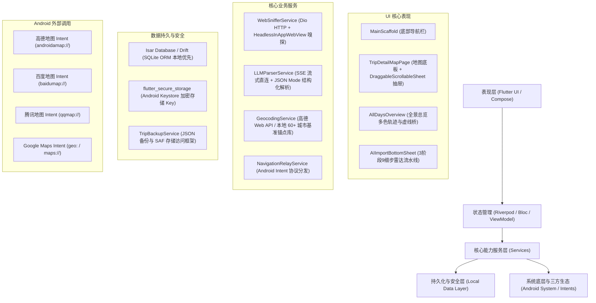
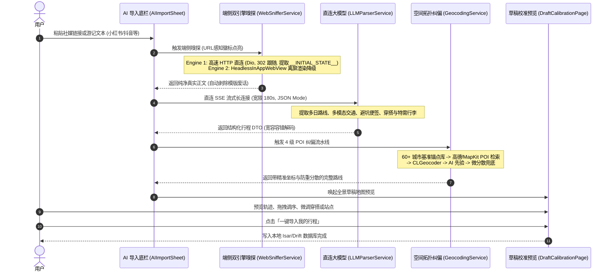
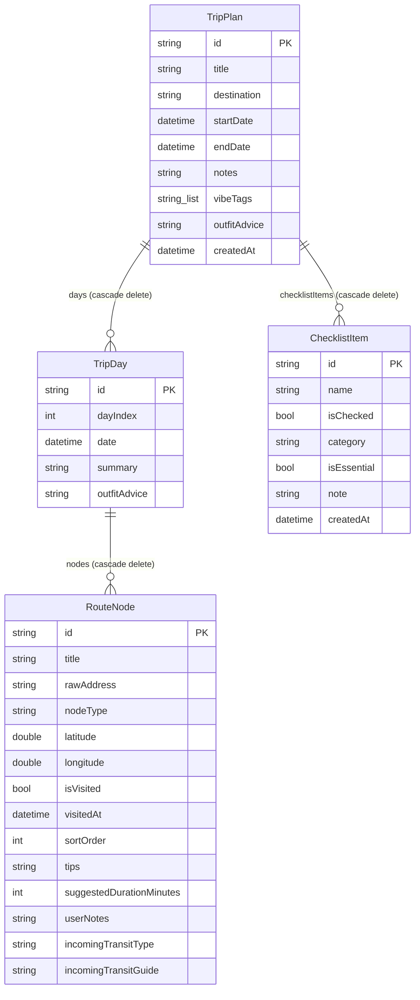

# 「你的旅游」（JustYourTrip）产品功能说明书 (Flutter / Android 原生落地方案)

> **文档版本**：v1.0.0 (Flutter / Android Edition)  
> **适用平台**：Android 8.0+ (API Level 26+) / 跨平台 Flutter (兼容 Android & iOS)  
> **核心架构**：Flutter 3.x (Dart 3.x) / Android Jetpack + Compose，本地优先（Local-First）  
> **文档定位**：全功能产品功能规范（PRD）+ 移动端技术落地架构指南

---

## 一、 产品概述与定位

### 1.1 产品定位
「你的旅游」（英文名：*JustYourTrip*）是一款面向独立旅行者、Citywalk漫游者与特种兵出行用户的**闭环个人出行管理中枢**。

在 Android / Flutter 生态下，绝大多数出行应用严重依赖中心化云端服务器、充斥大量商业信息流、且不同平台体验割裂。JustYourTrip 恪守**本地优先（Local-First）、零服务器开销、绝对隐私（BYOK）、真实路网串联**的纯净极客理念，将**社媒图文攻略端侧抓取、直连大模型智能解构、高精地图底板抽屉联动、多模态路网换乘、行前装备管理与旅行回忆足迹**完整沉淀于用户端侧设备中。

### 1.2 核心设计哲学
1. **本地优先（Local-First）**：
   - 数据完全驻留在端侧设备数据库（推荐 Isar / Drift SQLite），毫秒级极速响应，离线弱网状态下 100% 顺畅使用。
2. **绝对隐私与 BYOK（Bring Your Own Key）**：
   - 端侧直连大模型开放协议（DeepSeek / OpenAI / Kimi / 硅基流动等），API Key 经由 Android Keystore 加密存储，绝不上报中转服务器。
3. **真实路网与多模态交通串联（Multi-modal）**：
   - 不仅管理景点，更将地铁出入口、公交站点、停车场作为一等公民节点纳入路线；利用 Android Intent 机制一键无缝唤醒高德地图、百度地图、腾讯地图或 Google Maps 进行真实巡航导航。
4. **旅行手账质感美学（Material 3 + Hand-drawn Vibe）**：
   - 森林极深绿（`#0D2620`）基底、鼠尾草薄荷绿（`#52B788`）高光，搭配多层物理纸质卡片、毛玻璃边框与振动触觉反馈。

---

## 二、 目标用户画像与核心场景

| 用户画像 | 典型场景 | 核心诉求 | JustYourTrip 解决方案 |
|---|---|---|---|
| **小红书/抖音攻略收集狂** | 收藏了十几篇图文游记，出发时手忙脚乱在各应用间切屏翻找 | 想要一键把社媒博主游记直接变成地图上的直观路线 | **端侧双引擎 AI 智能嗅探**：粘贴短链秒级解析，提取多日路线、避坑要点与穿衣指南 |
| **Citywalk / 特种兵自由行** | 每天打卡 8~10 个点，换乘复杂，频繁输入地名导航 | 想要清晰知道“从哪站几号口出”，并能一键启动地图导航 | **一体化抽屉时光轴 + 多模态连线 + 导航中继**：详细换乘指引胶囊，一键 Intent 调起高德/百度 |
| **多日连线长途漫游者** | 5~7 天跨城或环线游，每天行程断裂，缺乏全程掌控感 | 想要总览全程动线、清楚夜间住在哪里、第二天如何衔接 | **全景总览模式 + 跨日渐变虚线桥梁**：多日分色共显轨迹，渲染夜间休整与次日启程过渡卡片 |
| **注重隐私的极客/户外驴友** | 担心出行数据被大数据画像，身处偏远山区常遇弱网断网 | 绝不上报隐私数据，离线可用，支持自主导出备份 | **Local-First + BYOK + 离线数据保险库**：无账号、无服务器、全量 JSON 导出恢复 |

---

## 三、 Flutter / Android 技术选型与架构全景



### 3.1 关键选型推荐矩阵 (Flutter 推荐 / Android 原生对照)

| 模块能力 | Flutter 跨平台推荐技术栈 | 原生 Android (Kotlin) 对照技术栈 | 说明与选型理由 |
|---|---|---|---|
| **UI 框架** | Flutter 3.x + Material 3 | Jetpack Compose + Material 3 | 声明式响应式布局，保证 60/120fps 高刷 |
| **状态管理** | `flutter_riverpod` 或 `flutter_bloc` | `ViewModel` + `StateFlow` | 严格单向数据流，保证复杂抽屉与地图联动状态解耦 |
| **本地数据库** | **Isar Database** 或 **Drift (SQLite)** | **Room (SQLite)** | 支持强类型对象映射、复杂关系查询、级联删除与离线毫秒级存取 |
| **安全存储 (BYOK)** | `flutter_secure_storage` | `EncryptedSharedPreferences` (Keystore) | 将大模型 API 密钥存放在硬件隔离的 Android Keystore |
| **地图服务底板** | `amap_flutter_map` (高德) / Mapbox | 高德地图 Android SDK / 百度地图 SDK | 国内底板推荐高德/百度，国外可无缝切 Mapbox / Google Maps |
| **一体化手势抽屉** | `DraggableScrollableSheet` | Compose `BottomSheetScaffold` | 支持物理吸附阻尼（0.25折叠、0.5半屏、0.95全屏） |
| **端侧无头嗅探** | `dio` + `flutter_inappwebview` (Headless) | `OkHttp` + Android `WebView` (离屏) | 双引擎架构：高速 HTTP 优先，动态 SPA 离屏渲染降级 |
| **导航中继唤醒** | `url_launcher` / `android_intent_plus` | Android 原生 `Intent` 隐式启动 | 智能识别并带参唤起高德、百度、腾讯及 Google Maps |
| **文件共享备份** | `file_picker` + `share_plus` | Storage Access Framework (SAF) + 分享 Intent | 标准化导出/导入全量 `.json` 数据包 |

---

## 四、 核心功能模块详细说明

### 4.1 模块一：行程规划与管理（Trip Management）

#### 4.1.1 行程首页与卡片流
- **探索感 Header**：动态标语展示与出行总览。
- **旅行画册卡片（Modern Travel Card）**：
  - **出行状态智能流转**：自动比对手机系统本地时间，实时呈现状态胶囊：
    - `今日出发`（高亮珊瑚红渐变光圈）；
    - `旅途中`（动态脉冲微标）；
    - `X天后出发`（出行倒计时天数）；
    - `已全部打卡 / 漫游回忆`（历史归档灰度态）。
  - **路线亮点微缩步进器（Mini Itinerary Stepper）**：卡片直接透出前 3 站精选地点与对应类型图标（景点/美食/交通），右侧展示“+N 站”未展开微标。
  - **Trip Vibe 情绪风格标签**：支持「自然风光、城市漫游、历史古迹、特种兵刷步、微醺夜游、海岛度假、人文艺术、硬核徒步、美食品鉴」等点选展示。
  - **穿搭指南微标**：卡片提取核心着装关键词（如 `#防风薄外套`、`#平底暴走鞋`）。
  - **卡片展开动画**：支持平滑容器过渡动画（Open Container Transition / Hero 动效），点击卡片平滑展开放大至地图全屏。

#### 4.1.2 地图底板与抽屉联动系统（TripDetailMapPage）
- **一体化视图层次架构**：
  - 地图底板与底部时间轴抽屉严格归属于同一个 Scaffold 页面中，杜绝系统独立弹窗导致的异步割裂感与返回闪烁。
  - 完美兼容 Android 10+ 全屏幕边缘手势侧滑返回（Predictive Back Gesture）。
- **物理阻尼多档位吸附抽屉（基于 `DraggableScrollableSheet`）**：
  - `折叠态（snapSize: 0.25）`：露头展示当日首站卡片与关键信息，最大化留出全景地图视野；
  - `半屏态（snapSize: 0.50）`：地图底板与时间轴 1:1 均分视野；
  - `全屏态（snapSize: 0.95）`：时间轴沉浸式展开，留出顶部半透明悬浮控制岛；
  - 支持惯性抛掷、微阻尼回弹，支持点击抽屉抓手（Handle）一键在折叠态与半屏态之间自适应切换。
- **顶部悬浮控制岛（Floating Island）**：
  - 呈现半透明毛玻璃药丸形态，内置返回按键、当前游玩天数、打卡站数统计；
  - 内置「一键全览（Focus All）」按键：点击后自动将抽屉降至折叠态，并动态计算几何包围盒（Bounding Box），镜头平滑缩放至覆盖当日所有打卡点。

#### 4.1.3 全景总览模式与跨日交接桥梁（All-Days Overview Mode）
- **横向切换栏专属胶囊**：天数横向切换栏首位固定呈现「🗺️ 全景总览 · N天」胶囊，与 `Day 1`、`Day 2` ... `Day N` 无缝平滑切换。
- **全程轨迹多色共显**：
  - 全景模式下，地图同时渲染各天专属色彩（墨绿、珊瑚红、琥珀金、优雅紫、湖海青等）的实线轨迹连线；
  - 动态图钉徽标：全景模式下呈现 `D1-1`、`D1-2`、`D2-1`，图钉背景色与光晕同步匹配所属天数主题色。
- **跨日过渡渐变虚线桥梁（Cross-day Bridge Polyline）**：
  - 算法自动计算 Day $K$ 的终点（如酒店/晚间餐饮）与 Day $K+1$ 的起点（如晨间景点），在地图上渲染精美虚线桥梁，直观呈现夜间迁移与次日启程的地理空间过渡。
- **连续时间轴与跨日交接卡片**：
  - 抽屉内连续纵向展开全程各天站点，各天前置专属色彩的分组 Header，支持一键「只看这天」秒切单日专注视图；
  - 各天连接段之间嵌入「🌙 夜间休整 · 跨日衔接」卡片，消除以往攻略“每天之间相互割裂断开”的痛点；
  - 在单日模式下，顶部自动渲染「🌅 承接前日行程」快捷查看条，底部渲染「🌙 结束今日 · 次日启程预告」跳转卡片。

#### 4.1.4 多模态混合交通节点与打卡流转
- **节点类型（`NodeType`）**：
  - 景点（attraction）、美食餐饮（restaurant）、住宿酒店（hotel）、公交站（transitBus）、地铁站/出入口（transitSub）、停车场（parkingLot）、其他（other）。
- **路段交通连线（`TransitType`）**：
  - 步行（虚线）、自驾/打车（实线）、公共交通/地铁（彩色粗线）。
  - 节点卡片附带详细换乘指引（例如：“乘地铁2号线往浦东机场方向，坐3站至陆家嘴站C口出”）。
- **打卡状态机流转**：
  - 点击卡片「打卡」按钮，触发 Android 原生触觉微振（`HapticFeedback.lightImpact`）；
  - 节点状态由“待去（白色发光数字图钉）”变更为“已打卡（鼠尾草薄荷绿完成态）”；
  - 打卡完成后卡片自适应柔和变灰，时间轴发光指示圈顺延流动至下一站，顶部完成度环形统计即时刷新。

#### 4.1.5 行程全生命周期闭环（CRUD、跨天调度与排序）
- **查（View）**：高精地图多模态轨迹、数字序号图钉、竖向步进时间轴、避坑便签协同浏览。
- **增（Create）**：支持在任意日程内追加地点（`AddNodeDialog`），天数切换栏末尾支持一键「+ 加一天」动态延展行程。
- **删（Delete）**：卡片右侧快捷操作与长按菜单均集成红色安全删除，弹出二次防误触对话框；支持长按天数胶囊删除冗余日程（级联删除旗下所有节点）。
- **改（Update & Cross-day）**：支持全要素编辑地名、类型、停留时长、换乘指引、避坑指南；内置地图搜索精准选点与 POI 纠偏；提供「所属天数」下拉选择器一键跨天调度。
- **调（Reorder & Drag）**：
  - 快捷单步调序：卡片内置「上移一位」与「下移一位」触感交互；
  - 全景拖拽重排：抽屉操作栏常驻「调序」按键，呼出基于 `ReorderableListView` 的原生列表拖拽弹窗，自由重排当日站点。

---

### 4.2 模块二：混合交通导航中继服务（Navigation Relay via Android Intents）

Android 平台具备极为开放强大的 Intent 隐式调用能力。本模块针对中国大陆及海外主流地图应用提供专属 Intent 协议封装：

#### 4.2.1 协议适配矩阵

| 目标地图客户端 | Android 协议格式 (Intent Action / URI) | 携带核心参数 |
|---|---|---|
| **高德地图** (AMap) | `androidamap://route/plan?sourceApplication=JustYourTrip&dlat={lat}&dlon={lon}&dname={name}&dev=0&t={mode}` | 终点经纬度、地名、出行方式（`t=1`驾车、`t=2`公交、`t=3`步行） |
| **百度地图** (Baidu) | `baidumap://map/direction?destination=name:{name}\|latlng:{lat},{lon}&mode={mode}&coord_type=wgs84` | 终点经纬度、地名、出行方式（`driving`、`transit`、`walking`） |
| **腾讯地图** (Tencent) | `qqmap://map/routeplan?type={mode}&to={name}&tocoord={lat},{lon}&referer=JustYourTrip` | 终点经纬度、地名、出行方式（`bus`、`drive`、`walk`） |
| **Google Maps** (海外) | `google.navigation:q={lat},{lon}&mode={mode}` 或 `geo:{lat},{lon}?q={lat},{lon}({name})` | 终点经纬度、模式（`d`驾车、`b`公交、`w`步行） |

#### 4.2.2 优雅调度与降级机制
1. **客户端存在性检测**：通过 `canLaunchUrl` 检测用户手机上已安装的地图客户端；
2. **多地图选择弹窗**：若安装了多家地图，弹出 Material 3 风格底部选择列表（含高德、百度、腾讯图标），并支持记住用户默认偏好；
3. **无感降级**：若未安装任何三方地图，自动唤起浏览器打开高德/百度 H5 网页版导航或系统内置地图，确保 100% 导航可用。

---

### 4.3 模块三：智能穿搭指南系统（AI Outfit System）

- **AI 上下文智能推荐**：
  - 在社媒攻略导入时，自动深度解析原笔记中的穿衣穿搭、鞋帽装备、防风防晒建议；
  - 若原文未提及，AI 结合目的地气候特征、季节时令与路线活动强度（暴走步行多、江边/山顶风大、拍照出片等）生成贴心实用的穿搭指南。
- **草稿人机协同自主校准**：
  - 导入预览校准页专属「👔 AI 出行穿衣推荐与穿搭指南」手账卡片；
  - 用户在正式入库前可点击编辑，提供快捷标签选择流（`#早晚温差备外套`、`#轻便平底暴走鞋`、`#浅色系拍照出片`、`#洋葱穿法`）与一键模版生成。
- **抽屉与卡片深度集成**：
  - 抽屉顶部快捷操作栏常驻「穿搭」胶囊按键，任意形态一键呼起查看或编辑；
  - 全景总览模式展示全程指南，单日模式优先展示当日专属穿搭并无缝回退至全程指南；
  - 离线全量 JSON 备份与官方示例中均深度集成穿搭数据。

---

### 4.4 模块四：社媒攻略 AI 导入流水线（AI Import Pipeline）



#### 4.4.1 全场景链接感知与清洗
- 精准识别小红书（`xhslink.com/...`）、抖音（`v.douyin.com/...`）、微信公众号、携程、马蜂窝等各类带/不带协议头网址与短链接；
- 自动剥除分享文本末尾夹带的中文标点与多余干扰字符。

#### 4.4.2 双引擎端侧抓取架构（Dual-Engine Architecture）
- **Engine 1（高速 HTTP 直连，耗时仅 ~0.3s）**：
  - 基于 `Dio` 客户端，自动跟随 302 重定向；
  - 专精萃取小红书 `window.__INITIAL_STATE__` / `__INITIAL_DATA__`、`og:description`、`<meta name="description">`、`<title>` 与去除标签后的真实段落正文。
- **Engine 2（无头 InAppWebView 离屏降级兜底）**：
  - 针对重客户端 JS 渲染的 SPA 动态页面，提供离屏真实 DOM 注入与执行，防止被 Android 系统的激进后台策略节流。
- **反爬友好拦截指引**：
  - 若平台因反爬滑块拦截且用户未贴文案，立即阻断向大模型传递死链（杜绝大模型幻觉与报错），并在界面以高亮卡片给出清晰指引：“请在小红书长按文案选择「复制文案」，直接粘贴到输入框”，并附带一键重试与示例按钮。

#### 4.4.3 3 大核心主阶段与 9 大细分子步骤流水线
- **阶段 1：网页嗅探与文本准备**
  - 步骤 1：识别链接与准备抓取
  - 步骤 2：端侧抓取正文与模版净化
  - 步骤 3：文本就绪，构建结构化 Prompt
- **阶段 2：AI 智能行程解构**
  - 步骤 4：直连大模型长连接（SSE 宽限 180s）
  - 步骤 5：解构多日路线与多模态交通
  - 步骤 6：生成穿衣推荐、避坑建议与行前清单
- **阶段 3：空间拓扑与地理校准**
  - 步骤 7：锁定目的地基准城市锚点
  - 步骤 8：逐站高精 POI 校准（动态显示“第 X/N 站：地点名”）
  - 步骤 9：空间拓扑防重与离群优化

#### 4.4.4 60+ 热门城市基准锚点库与 4 层级混合高精 POI 纠偏
- **City Anchor Database**：内置全国 60+ 热门旅游城市高精中心基准，动态以目的地为几何原点约束检索范围（`radius: 80km`），从根源杜绝“同名景点跳往外省”造成的巨大飞线。
- **4 层级高精 POI 纠偏管道（Multi-tier Resolution Pipeline）**：
  - **Tier 1（地图原生/高德 Web API POI 检索）**：结合城市 Region 约束，精准秒级解析地标（如“武康大楼”、“安福路”、“东方明珠”）；
  - **Tier 2（地理反查）**：带城市前缀且施加 120km 离群阻断校验，拦截异地同名点；
  - **Tier 3（AI 经纬度先验注入与校准）**：大模型结构化输出先验经纬度，在符合城市半径时双向校验采纳；
  - **Tier 4（智能微分散局部兜底）**：未命中的罕见点自动依附于当日游玩前序站点，并施加角度微分散偏移，绝不堆叠重合。
- **拓扑健康度检查**：距离 < 20 米的异名站点自动向外分散（~180m），严重离群点强制拉回。

#### 4.4.5 草稿人机校准与一键入库（`DraftCalibrationPage`）
- 展现全景草稿地图、实线轨迹连线、数字序号 Pin、一键全览当日视野；
- 支持上下拖拽重排顺序、左滑删除、微调经纬度与游玩时长；
- 行前特需物品与穿搭指南一键同步存入端侧数据库。

---

### 4.5 模块五：全局足迹大地图（Footprint Map）

#### 4.5.1 视觉与成就岛（`FootprintMapPage`）
- **漫游探索成就岛（Achievement Header Island）**：顶部悬浮展示探索城市统计（如“探索 3 座城市”）、打卡回忆计数微标（如“点亮 18 个足迹”）。
- **全局打卡足迹聚类展示**：沉浸式深色大地图，聚合渲染所有已完成打卡（`isVisited = true`）的历史节点。

#### 4.5.2 智能过滤与多维度筛选
- **智能中转站过滤**：右上角提供“隐藏中转站”开关，自动剥离公交站、地铁口与停车场，足迹墙仅保留纯粹的风景、美食与人文。
- **多分类快捷筛选条**：支持在地图上快速筛选「全部 / 景点 / 美食 / 住宿」点位。

#### 4.5.3 明信片手账风回忆卡片（`FootprintCard`）
- 轻触历史足迹图钉，底部弹出轻量明信片风卡片；
- 呈现复古旅行邮戳徽章、打卡完成时间戳、所属行程计划名称与避坑手账随笔。

---

### 4.6 模块六：行前准备（Checklist 打包助手）

#### 4.6.1 双环形打包收纳仪表盘
- 顶部实时渲染双层圆形环状进度条：
  - 外环：所有物品收纳总进度百分比；
  - 内环：高优先级特需/关键必备物品完成状态。

#### 4.6.2 六大分类手账折叠卡片
- **分类维度**：
  1. `证件票务`（身份证、护照、交通卡、门票等）
  2. `数码装备`（充电宝、相机、转换插头、云台等）
  3. `穿搭衣物`（换洗衣物、舒适跑鞋、墨镜、雨具等）
  4. `个人药品`（晕车药、创可贴、感冒药、驱蚊液等）
  5. `个护洗漱`（旅行分装瓶、毛巾、防晒霜、洗漱包等）
  6. `其他定制`（U型枕、保温杯、零食等）
- 支持分类独立展开/折叠、分类专属彩色徽章与已收纳/待收纳计数胶囊。

#### 4.6.3 触感交互与模版快捷套用
- 勾选物品伴随 Android 触觉微振、文本删除线动画与完成状态平滑位移，支持侧滑快速删除；
- **一键套用 12 项经典模版**：内置新手出游必备清单，一键快速填装行李；
- **按行程切换胶囊条（Trip Picker Bar）**：自由在全局通用清单与各个独立行程打包清单间无缝切换。

---

### 4.7 模块七：设置中心与数据保险库（Settings & Data Vault）

#### 4.7.1 旅行护照风 Header
- 采用极客旅行签注设计，凸显“本地优先（Local-First）· 端侧纯净驱动 · 零商业上报”认证徽标。

#### 4.7.2 BYOK（自带密钥）配置与连通性 Ping
- **多模型预设一键切换**：支持 DeepSeek、OpenAI、Kimi、硅基流动等兼容协议，支持自定义 Base URL 与 Model Name；
- **端侧 Ping 延迟测试**：内置轻量探测请求，实时测量本地直连大模型 API 的往返毫秒数（Ping Latency），清晰感知网络可用性；
- **Android Keystore 硬件加密保护**：基于 `flutter_secure_storage`，密钥严格保存在端侧 Keystore，杜绝中转泄露。

#### 4.7.3 离线全量 JSON 数据备份与恢复（Data Vault）
- **一键全量导出**：将用户所有行程计划、多日日程、节点坐标、换乘指引、穿搭指南与行李清单完整打包生成标准化 `.json` 文件；
- **系统分享与本地存档**：支持唤起 Android 系统分享面板（可存至系统“下载/文件”、微信文件传输助手、网盘）；
- **全量无损恢复**：支持选择本地备份 `.json` 文件一键恢复，自动重构数据库并刷新界面。

#### 4.7.4 官方示例行程体验与重置
- 提供上海经典外滩与梧桐区漫游官方示例行程，支持一键重置与追加体验。

---

## 五、 数据实体模型设计 (Dart / Isar / Drift Schema)



---

## 六、 Android 原生与权限适配规范

### 6.1 Android 权限声明清单（`AndroidManifest.xml`）
```xml
<!-- 网络访问权限（用于端侧直连大模型 API、HTTP网页嗅探与地图瓦片加载） -->
<uses-permission android:name="android.permission.INTERNET" />
<uses-permission android:name="android.permission.ACCESS_NETWORK_STATE" />

<!-- 精准与粗略定位权限（用于行程地图定位当前位置） -->
<uses-permission android:name="android.permission.ACCESS_FINE_LOCATION" />
<uses-permission android:name="android.permission.ACCESS_COARSE_LOCATION" />

<!-- 触觉反馈权限 -->
<uses-permission android:name="android.permission.VIBRATE" />

<!-- Android 11+ (API 30+) 外部应用包可见性声明 (用于唤醒三方地图) -->
<queries>
    <!-- 高德地图 -->
    <package android:name="com.autonavi.minimap" />
    <!-- 百度地图 -->
    <package android:name="com.baidu.BaiduMap" />
    <!-- 腾讯地图 -->
    <package android:name="com.tencent.map" />
    <!-- Google 地图 -->
    <package android:name="com.google.android.apps.maps" />
</queries>
```

### 6.2 Android 存储访问框架 (SAF) 适配
- 备份文件的导出与恢复严格遵循 Android 10+ 分区存储（Scoped Storage）规范；
- 导出时默认将备份 JSON 写入应用专属缓存目录，并通过 `Share` Intent 调用系统选择器让用户保存至“下载”或任意外部目录，避免申请侵入式的 `MANAGE_EXTERNAL_STORAGE` 权限，完全符合 Google Play 与国内各大应用商店隐私合规要求。

---

## 七、 视觉规范与设计系统（Design System）

| 设计要素 | 属性 / 色值 | 视觉用途与心理感知 |
|---|---|---|
| **森林极深绿** (`forestDeep`) | `#0D2620` | 主界面深邃底色、沉稳基调、极客质感 |
| **经典墨绿** (`forestPrimary`) | `#1F5F4B` | 品牌主色、主卡片底衬渐变起点 |
| **鼠尾草薄荷绿** (`sageMint`) | `#52B788` | 核心高光、选中胶囊、打卡成功态 |
| **荧光微亮薄荷** (`luminousMint`) | `#74D7BA` | 渐变终点、高对比度图标与状态光圈 |
| **沙漠暖金** (`warmAmber`) | `#F4A261` | 美食推荐、Vibe 标签点缀、活力氛围 |
| **晚霞珊瑚红** (`sunsetCoral`) | `#FF6B52` | 核心打卡高光、今日出发倒计时急迫态 |
| **毛玻璃描边** (`cardGlassBorder`) | `white 35% -> 6%` | 空间立体边框，悬浮卡片柔和投影 |
| **卡片材质** | 多层物理纸质质感 | 传达旅行手账的真实书写与收纳感 |
| **触感反馈** | `HapticFeedback.lightImpact` | 选点、打卡、勾选时提供明确的物理震动反馈 |

---

## 八、 非功能性需求与性能指标（NFR）

1. **响应性能**：
   - 应用冷启动速度 $\le 800\text{ms}$（Flutter AOT 编译）；
   - 抽屉拖拽、手势滑动与地图缩放稳定保持 **60fps / 120fps** 高刷无卡顿；
   - 本地数据库查询读取在 200+ 节点规模下保持毫秒级（$< 8\text{ms}$）。
2. **端侧网页嗅探效能**：
   - HTTP 高速直连嗅探在网络良好情况下响应耗时 $\le 500\text{ms}$；
   - 离屏无头 WebView 渲染兜底超时阈值设定为 8 秒，兼顾稳定性与耗电控制。
3. **大模型直连健壮性**：
   - 采用 SSE 流式长连接传输，单次请求宽限高达 180 秒，杜绝长文本或慢速推理模型超时报错；
   - DTO 采用全量缺省安全解码，即便大模型返回字段缺损亦能平滑容错渲染。
4. **地理编码容错率**：
   - 城市锚点 80km 约束圈配合 4 级纠偏，同城识别率 $> 98\%$，跨省飞线率趋近于 $0\%$；
   - 重合坐标自动分散机制确保任何同点位异名站点之间间距保留适度视距（$\sim 180\text{m}$）。
5. **权限与隐私合规**：
   - 零不必要隐私权限索取，无广告 SDK，无三方数据统计追踪 SDK，符合国内工信部合规与 Google Play 隐私安全政策。

---

## 九、 产品演进路线图（Roadmap）

- [x] **v1.0.0（当前版本 · 全闭环单机中枢）**：
  - 行程时间轴与多模态交通、全景总览与跨日交接桥梁；
  - 智能穿搭指南与行前打包清单；
  - 双引擎社媒攻略端侧 AI 导入与 4 级 POI 纠偏；
  - 足迹大地图与明信片回忆面板；
  - BYOK 配置、端侧 Ping 与离线 JSON 备份恢复。
- [ ] **v1.1.0（Android 平板/折叠屏与长图分享）**：
  - **折叠屏与平板宽屏响应式布局**：基于 `LayoutBuilder` 实现左侧时间轴、右侧大地图的双栏 Split 联动；
  - **路书长图分享导出**：基于 `RepaintBoundary` 一键将全景路书渲染为高保真长图导出。
- [ ] **v1.2.0（私有端对端同步）**：
  - 基于 WebDAV / 私有云盘的静默离线同步方案，不设中心化商业服务器，保持纯粹 Local-First 理念。
